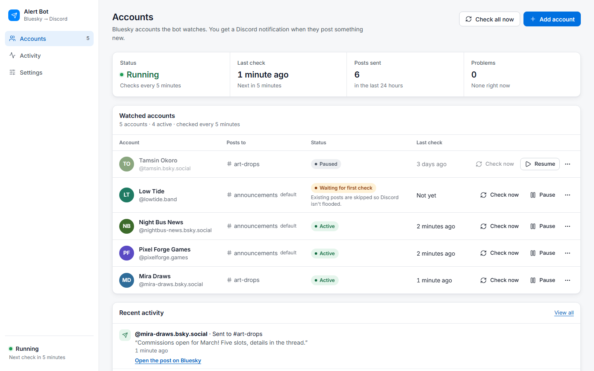
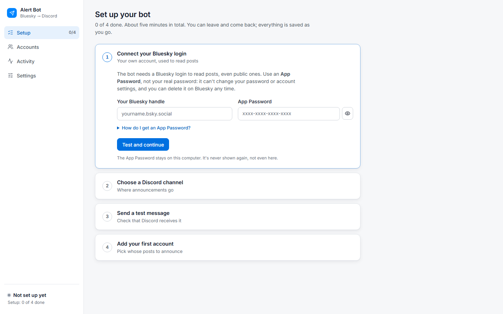

# Bluesky → Discord Alert Bot

This bot watches **any public Bluesky accounts you choose** (artists, news accounts, creators, anyone) and posts their new posts as announcements in your Discord channels.

**No coding needed.** You install one program, Docker Desktop, then double-click a file. Everything else happens in a control panel in your web browser.



---

## What it does

Every few minutes the bot looks at the Bluesky accounts you picked. When one of them posts something new, a message like this appears in your Discord channel:

```
┌──────────────────────────────────────────┐
│  New post from Someone Cool              │
│                                          │
│  "Hello everyone! Here's my new post."   │
│                                          │
│  @someone.bsky.social on Bluesky         │
└──────────────────────────────────────────┘
```

Clicking the title opens the post on Bluesky.

- **Any public account works.** It doesn't have to be yours.
- **Several Discord channels:** each watched account can post to its own channel, or to your default one.
- **Nothing old is announced.** When you add an account, the bot notes its existing posts without sending them, so your channel isn't flooded.
- **Runs on your own computer.** Your passwords and settings never leave it; only the announcements go to Discord.

---

## What you need

- A Windows 10 or Windows 11 computer (64-bit) that stays on while you want announcements.
- **Docker Desktop**: free for personal use and small organisations. The next section shows how to install it.
- A **Bluesky account** of your own. The bot signs in with it to read posts.
- A **Discord server** where you can manage channels.

You don't need Python, Node.js, Git or any other tools, and you never need to type commands.

---

## Step 1: Install Docker Desktop

Docker Desktop is the program the bot runs inside. You install it once.

1. Go to **https://www.docker.com/products/docker-desktop/** and download **Docker Desktop for Windows**.
2. Open the downloaded file and follow the installer. Keep the option **"Use WSL 2"** ticked.
3. **Restart the computer** when the installer asks.
4. Open **Docker Desktop** from the Start menu. Accept the terms when it asks. You can skip signing in; it isn't needed.
5. Wait until the bottom-left corner says **"Engine running"**.
6. Open Docker Desktop's **Settings** (the gear icon) and make sure **"Start Docker Desktop when you sign in to your computer"** is ticked. This brings the bot back by itself after you restart the computer.

> **If Docker Desktop says "WSL" needs to be installed or updated,** let it do so, or follow the link it shows, then restart the computer.
> **If it says virtualization is turned off,** it has to be switched on in the computer's BIOS/UEFI settings. Search the web for your computer model plus "enable virtualization", or ask someone who knows your computer.

---

## Step 2: Install the bot

1. Put the bot's folder somewhere permanent, for example in **Documents**. (If you downloaded a `.zip` file, right-click it and choose **Extract All** first.)
2. Double-click **`setup.bat`**.
   - The first time it takes a few minutes: it prepares the bot inside Docker Desktop.
   - If you used an **earlier version** of this bot in the same folder, setup offers to bring over its accounts and settings. Answer **Y**. The old files are only read, never changed.
   - When it's ready, the control panel opens in your browser at **http://127.0.0.1:8000**.

You can close the black window afterwards. The bot keeps running inside Docker Desktop.

---

## Step 3: Set it up in the control panel

The control panel walks you through four steps the first time.



### 1. Connect your Bluesky login (an App Password)

> **This is your own Bluesky login, not the accounts you want to watch.** Bluesky only lets signed-in apps read posts, even public ones. Think of it like a library card: the card is yours, but you can read any book.

Use an **App Password**, not your real password. It's safer, and you can delete it any time to cut the bot off.

1. Sign in at **bsky.app**.
2. Open **Settings → Privacy and Security → App Passwords**.
3. Choose **Add App Password**, name it `discord-bot`, and copy the password it shows (it looks like `xxxx-xxxx-xxxx-xxxx`). You won't see it again.
4. In the control panel, enter your Bluesky handle (for example `yourname.bsky.social`) and paste the App Password, then press **Test and continue**. The bot checks the login before saving it.

### 2. Choose a Discord channel (a Webhook URL)

A webhook URL is a special link from Discord that lets the bot post in one channel.

1. In Discord, hover over the channel for announcements and click its **gear icon** (Edit Channel).
2. Open **Integrations → Webhooks → New Webhook**.
3. Name it `Bluesky Bot` (this is the sender name shown in Discord) and choose **Copy Webhook URL**.
4. In the control panel, give the channel a name and paste the URL. Keep the URL private: anyone with it can post in that channel.

### 3. Send a test message

Press **Send test message** and look in your Discord channel. If nothing arrives, the panel tells you what to check.

### 4. Add your first account

Type the handle of any public Bluesky account. The panel looks it up and shows the profile before you add it. Its first check runs straight away and only notes the existing posts, so **nothing appears in Discord until that account posts something new.**

---

## Every day

Everything happens in the control panel at **http://127.0.0.1:8000** (bookmark it).

| Page | What you do there |
|---|---|
| **Accounts** | See whether the bot is running, add accounts, **Check now**, **Pause / Resume**, edit or remove accounts, **Check all now** |
| **Activity** | Everything the bot sent, and any problems, with what to do about them |
| **Settings** | Your Bluesky login, your Discord channels (add, test, change the default), how often to check, light or dark look |

The status at the bottom of the sidebar says whether the bot is running. Click it for details. If something needs your attention, a coloured banner explains it and offers the fix.

### The files in the bot's folder

| Double-click | What it does |
|---|---|
| `start.bat` | Starts the bot (if it isn't running) and opens the control panel |
| `stop.bat` | Stops the bot. Nothing is deleted. It stays stopped until `start.bat`. |
| `update.bat` | Installs a new version. Backs up first; your accounts and settings are kept. |
| `backup.bat` | Saves a backup copy into the `backups` folder |
| `restore.bat` | Puts a backup back. It shows the backups, newest first, and backs up the current data before restoring. |
| `setup.bat` | First-time installation (running it again is safe) |

**The bot runs while Docker Desktop runs.** Closing Docker Desktop or shutting down the computer pauses the announcements; they start again by themselves when Docker Desktop is back. Posts made in between are announced at the next check.

---

## Backups and your data

- Your accounts, settings and history are stored **inside Docker Desktop**, on this computer. Updating, restarting or re-running setup never deletes them.
- **Automatic backups** are made before every update and before every database change.
- **`backup.bat`** makes one whenever you like. Copies go into the **`backups`** folder next to the scripts.
- **Backups contain your App Password and webhook URLs.** Keep that folder private, and don't share it.
- **To go back to a backup,** double-click `restore.bat` and type the number of the backup.

---

## Troubleshooting

Every script explains problems in plain words and never deletes your data.

**"Docker Desktop isn't installed" or "isn't running yet"**
→ Install or open Docker Desktop (Step 1) and wait for "Engine running". The scripts try to start it for you.

**"Docker Desktop is open, but it isn't responding"**
→ Answer **Y** and the script restarts Docker Desktop for you. If it keeps happening, restart the computer, and install Docker Desktop's updates.

**"Another program is already using port 8000"**
→ If an older version of this bot is running in a black window, close it (two copies would announce everything twice). Otherwise open `docker\compose.env` in Notepad, change `ALERTBOT_PORT=8000` to another number such as `8080`, and use `http://127.0.0.1:8080`.

**"Can't reach the bot" in the control panel**
→ Open Docker Desktop, then double-click `start.bat`. The page reconnects by itself.

**Nothing appears in Discord after adding an account**
→ That's expected: the first check only notes existing posts. The next new post from that account will be announced.

**"Bluesky didn't accept the login"**
→ The App Password was deleted or mistyped. Make a new one (Step 3.1) and paste it under **Settings → Bluesky login**.

**The test message didn't arrive in Discord**
→ The webhook may have been deleted in Discord. Make a new webhook (Step 3.2) and paste its URL under **Settings → Discord channels → Edit**.

**Something else**
→ The scripts save a report in `logs\problem-report.txt` (passwords and webhook links are hidden). Share that file when asking for help.

---

## Coming from an earlier version (the black-window version)

1. Close the old bot's black window.
2. Install Docker Desktop (Step 1).
3. Double-click `setup.bat` in the same folder and answer **Y** when it offers to bring over your accounts and settings.

Your old `db.sqlite3` and `.env` files are only read. After moving, you can keep them as a spare copy, but don't start the old version again, or every post would be announced twice. The old scripts are in the `dev` folder for developers.

---

## More information

- [docs/DOCKER.md](docs/DOCKER.md): how the Docker version works, updates, backups, restoring, and releases.
- [docs/FRONTEND.md](docs/FRONTEND.md): the control panel, for developers.
- [docs/API.md](docs/API.md): the bot's API, for developers.
- [CONTRIBUTING.md](CONTRIBUTING.md): for developers: the project's layout, working on the panel or the backend separately, the API contract (`docs/openapi.yaml`), tests and CI.

## License

The bot is free and open source under the [MIT License](LICENSE). You may use, copy, change and share it, including commercially, as long as the copyright and license notice stay with it. It comes with no warranty.

It is built on other open-source software, which keeps its own licenses. This project is not affiliated with Bluesky or Discord.
